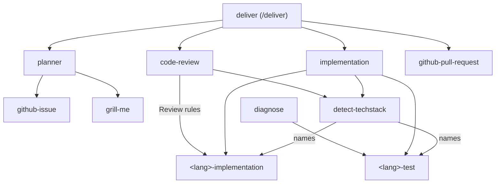

# Skill composition

One skill owns a workflow; the others delegate to it by name. Nothing is hard-coded per language: `detect-techstack` names the language skills at run time.

## Layers

- **Language skills.** Every language group has `<lang>-implementation` (conventions and a `## Review rules` section) and `<lang>-test`.
- **Shared skills.** `detect-techstack` returns a JSON report with those skill names. `implementation` enforces "every change has tests" and dispatches to the language skills. `code-review` checks a diff against the criteria and each language's review rules and reports blocking findings and notes. `diagnose` builds a red-capable feedback loop for bugs with the commands of `<lang>-test`.
- **Issue skills.** `github-issue` routes issue work by label and sub-issue shape (see the [issue model](issue-model.md)); `github-pull-request` opens the PR; `github-release` and `github-milestone` handle releases.
- **Workflow skills.** `planner` plans an issue one level down. `deliver` chains planner, `implementation`, `code-review` and the PR PBI by PBI, see [delivery](../delivery.md).

You can run any layer alone in one session; `deliver` only automates the chain.

## Related

- [Skills](skills.md)
- [Issue model](issue-model.md)
- [Work an issue by hand](../guides/work-an-issue-by-hand.md)
