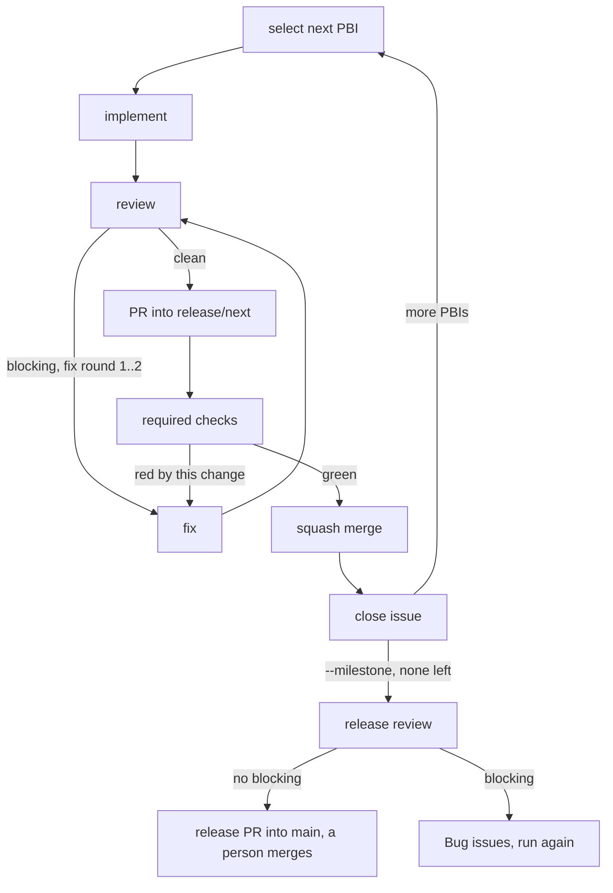

# Deliver issues with /deliver

`/deliver` takes open PBIs and Bugs and carries each one to a merged PR in `release/next`, one subagent per step. This guide walks through the common runs. Review file, release review, decision PBIs, parallel runs and roles are in the [delivery reference](../delivery.md).

::: tip Prerequisites
- `gh auth status` works and you can push to the repository.
- The branch `release/next` exists (`github-release` `cut` creates it).
- A GitHub ruleset on `release/next` with required checks and no bypass. It is the hard gate: a red check blocks the merge whatever the session does. `/deliver` warns at the start when there is none.
- Unattended runs need `git`, `gh` and your verify commands on the harness allowlist (`references/permissions.md` of the `deliver` skill).
- The [release guide](release.md) covers the branch, the milestone and the ruleset.
  :::

## The loop



Fix rounds are at most 2 per PBI, shared by review and CI; a third is a pause. The merge never asks when the review is clean and the checks are green.

## Deliver one PBI

```text
/deliver 42
```

`deliver` prints one line per step and ends with a report (shortened):

```text
#42 select: next, claimed
#42 implement: done, 3 commits, tests green
#42 review: 1 blocking -> fix 1/2
#42 review: clean
#42 pr: #57
#42 ci: green
#42 merge: squashed, issue closed
#42 cleanup: 2 removed

delivered: #42 https://github.com/acme/app/pull/57
blocked:   -
paused:    -
```

A blocked PBI (a red check unrelated to the change, for example) is listed with its reason and open PR; a paused one with its question. Interactive runs ask you right away: retry, skip or give an instruction.

## Deliver a Feature or several issues

```text
/deliver 7
/deliver 9 11 14
```

A Feature or Epic expands to its open PBIs and Bugs. They are ordered by their blocked-by links and each is delivered once. Issues with a blocking label are skipped (labels: [issue model](../concepts/issue-model.md#labels); hint `planner refine <nr>`). A Feature without PBIs is planned in the same session with `planner` and `grill-me` ([plan an issue](plan-an-issue.md)).

## Deliver a milestone

```text
/deliver --milestone 1.3.0
```

Delivers every open PBI and Bug of the milestone. When none is left, `deliver` runs a release review of the whole release diff. Without blocking findings it opens the release PR into `main` and stops: you review and merge that one. With blocking findings it files one Bug per finding in the milestone; run the command again to deliver them.

## Interactive or unattended

By default an unclear criterion, extra scope or a blocker asks you in the chat. With `--unattended` (`claude -p`, `opencode run`, `copilot -p`) nothing is asked: `deliver` comments on the issue, adds `needs-decision` and continues with the next independent PBI.

```text
/deliver 7 --unattended
```

Example of a pause, the comment on #43:

```text
deliver paused: criterion 2 ("export in the usual format") does not say which format.
Options: CSV or JSON. Answer here and remove the label needs-decision.
```

To continue: answer in the issue, remove the label (`gh issue edit 43 --remove-label needs-decision`) and run `/deliver 43` again. The report lists the paused PBI under `paused` with the question.

## Resume after a stop

State lives in GitHub only (issue, branch, PR, checks). After a crash, a closed terminal or a pause, run the same command again: an existing branch is continued, an existing PR skips straight to the checks, closed issues are not selected. `/deliver <nr>` on a single PBI continues it even when another session claimed it.

## Limit a run with --max

```text
/deliver --milestone 1.3.0 --max 3
```

`--max <n>` stops after `n` delivered, blocked or paused PBIs and prints the report. Run it again for the next batch.

## A release in fresh sessions

One session over a whole release grows large. `Invoke-DeliverLoop.ps1` starts a fresh `claude -p "/deliver … --unattended --max 1"` per PBI and reads the progress from GitHub:

```powershell
pwsh .claude/skills/deliver/scripts/Invoke-DeliverLoop.ps1 -Milestone 1.3.0 -Max 5 -Model sonnet
```

It stops when everything is done or `-Max` is reached (exit 0), when no progress is made (1) or a PBI is blocked (2). The stream log is in `.agents/deliver-loop/`. Details: `references/loop.md` of the `deliver` skill.

## Next

[Delivery reference](../delivery.md): review file, release review, decision PBIs, parallel runs, herdr and roles. Options: `/deliver help`.
