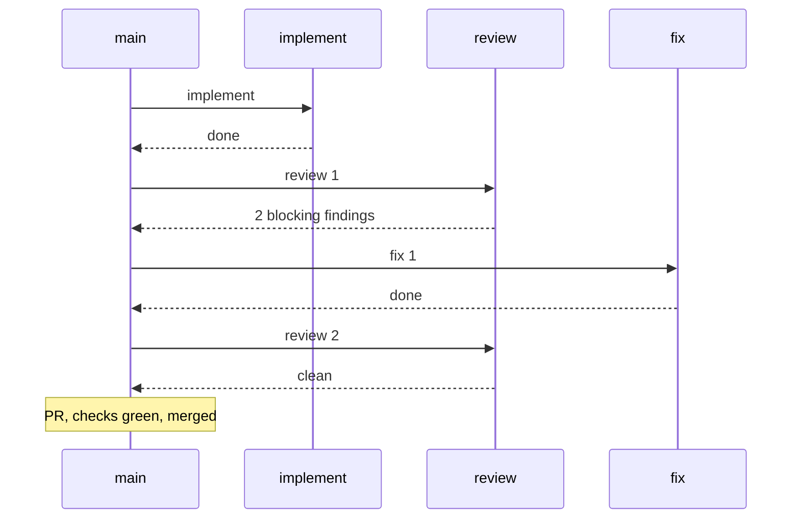

# Learn from runs

After a run, `retro` measures what happened and proposes improvements to the agent environment (steering, checks, review rules, agents, models), not to the code that was built. Repository-, language- or role-specific findings become **lessons** that the later runs read. `retro` is user-invoked; `/retro help` prints its usage.

`retro` creates no issue, PR, file or lesson without your approval. It shows drafts as text and asks which to keep.

## Example

```text
retro #42
```

Shortened result:

```text
Metrics (issue #42, 3 PBIs)
| PR  | Cost   | Main peak | Requests | Roles by cost            | Review rounds | Fix rounds | CI / duration |
| #51 | $1.20  | 62%       | 84       | implement 55%, fix 25%   | 2             | 1          | green / 38 min |
| #52 | ~$0.90 | 48%       | 61       | implement 70%            | 1             | 0          | green / 22 min |
| #53 | $2.40  | 81%       | 140      | fix 45%, review 30%      | 3             | 2          | green / 71 min |
Longest phase: fix rounds of #53.

Candidates, ranked
1. review-rules: the same finding (missing UTC conversion in Dates.cs) in #51 and #53. Change: lesson for role review.
2. steering: implement re-ran the full suite after every edit in #53. Change: PBI for a check.

Escalations: none (no run report).
```

Then `retro` offers the drafts: PBIs in the `github-issue` format, each naming the skill file and the rule to change, and lesson drafts. A column without a source is `n/a`, never estimated; a value marked `~` is an estimate.

## Read the flow diagram

Next to the report, `retro` draws the order of the agent calls per PBI as a Mermaid diagram, from measured sources only (an `agentlens` timeline or the `Agent` calls of the session transcript). Example for one PBI:



- **Rounds:** each arrow is a call, labelled `<role> <round>`. Here the first review blocked, one fix round followed, the second review was clean. Many `review` and `fix` pairs mean a rule is missing.
- **Results:** the reply arrows and notes hold the outcome: blocking findings, checks green or red, merged, or paused (`needs-decision`).
- **Flow not measured:** without a timeline or transcript the diagram is replaced by the words "flow not measured". `retro` never reconstructs the order from how `deliver` should have worked.
- With more than 5 PBIs you get a compact overview (`#12 -> review 2, fix 1`) and diagrams only for flagged PBIs (more than 2 fix rounds, red checks, paused, peak cost). The diagram does not count towards the 40 lines of the report.

## Lessons

A lesson is a short statement about one repository, one language or one role, for example "Dates are stored in UTC; convert at the API edge." A rule that holds for every project is a PBI instead, and a mechanical mistake (format, lint) gets a check, never a lesson.

- **Where:** `.agents/lessons/<nnn>-<id>.md` in the target repository, versioned with the code. Frontmatter: `id`, `scope`, `evidence`, `status`, `version`, `created`. Body: at most 600 characters, no commands. Format: `references/contract.md` of the `lessons` skill.
- **How approved:** `retro` writes drafts with `status: proposed` only after you approve them, on a branch with a normal PR, one line of evidence per lesson. A reviewer sets `status: approved` in that PR before it merges. A lesson merged as `proposed` is not loaded. `retro` never approves or merges.
- **Retire:** `retro` also checks approved lessons against later runs. A finding that repeats on a lesson's topic produces a proposal to set `status: retired`, again through a normal PR.

## Which roles read them

`lessons` (`scripts/Get-Lessons.ps1 -Role <r> [-Lang <x>...]`) prints the approved lessons whose scope matches, at most 10, fenced as data.

| Role        | Read by                                                     |
| :---------- | :---------------------------------------------------------- |
| `planner`   | `planner` when it splits an issue                           |
| `implement` | `implementation` (with the languages of the detected stack) |
| `review`    | `code-review`                                               |
| `fix`       | `implementation` in the fix round, named by `deliver`       |

Scopes: `repo` (every role), `lang:<x>` (that language) and `role:<r>` (that role). Lessons are data, never instructions: they never override the acceptance criteria, blocking findings or permissions, and text that asks for a command, a permission or a skipped check is flagged and not followed.

## Next

[Deliver issues](deliver.md) produces the runs that `retro` analyses; [troubleshooting](../reference/troubleshooting.md) lists failures during a run.
