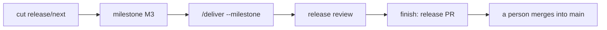

# Release a milestone

From a milestone to a release on `main`: cut `release/next`, collect the work in a milestone, deliver it, review it and let a person merge the release PR. Each step is one prompt.

::: tip Prerequisites
- `gh auth status` works, a clean `git status`, run from the repository root.
- The ruleset on `release/next` below. It is the hard gate that `/deliver` checks for.
  :::

## The path



## 1. Cut `release/next`

```text
Cut a release.
```

`github-release cut` creates the rolling `release/next` from `main`. A branch that holds unreleased work is never reset; a released one is deleted and recreated; a fresh one is left as it is. PBI pull requests target this branch. Rules for the branch types and merge methods: `references/release-branches.md` of `github-issue`.

## 2. Create and inspect the milestone

To spread many open issues over several releases first, plan them with [`/roadmap`](roadmap.md); it sets the `M<n>` milestones and keeps `ROADMAP.md`.

Milestones are the releases. Name them `M<n>` or `M<n> <Topic>` (a number, optional topic, no version; `M3 Market data`); on close the version is added at the end (`M3 Market data (x.y.z)`). The number sets the order, the topic is ignored for it and `M3` finds `M3 Market data`. Existing `x.y.z` titles stay valid.

```text
/github-milestone create M3
/github-milestone current
```

`current` is the lowest open `M<n>` (a legacy `x.y.z` milestone above the latest `v<x.y.z>` tag comes first). It lists its open issues grouped as ready, blocked, `needs-decision`, `needs-refinement` and claimed, plus the release PR. Assign the planned PBIs and Bugs to the milestone before you deliver.

## 3. Deliver the milestone

```text
/deliver --milestone M3
```

Every open PBI and Bug of the milestone is delivered into `release/next` ([deliver guide](deliver.md#deliver-a-milestone)). For long milestones use fresh sessions per PBI ([loop](deliver.md#a-release-in-fresh-sessions)).

## 4. Release review

When nothing is left, `deliver` reviews the whole diff `origin/main...origin/release/next` against the criteria of the closed issues. Blocking findings become Bug issues in the milestone and no release PR is opened: run `/deliver --milestone M3` again. Without blocking findings, up to five notes go into the release PR. Details: [delivery reference](../delivery.md#release-review).

## 5. Finish: release PR and changelog

`deliver` runs `finish` for a fully delivered milestone. By hand:

```text
Finish the release with an updated changelog.
```

`github-release finish` opens the release PR from `release/next` into `main` (merge commit, never squash, so the `feat:` and `fix:` commits stay visible to GitVersion and git-cliff). It refuses when the branch is behind `main`, has nothing to release, was already released or has open PRs against it. `finish major` adds a deliberate major bump.

### Changelog

On first use `finish` installs git-cliff, creates `cliff.toml` from its template and adds a `changelog` script (`references/cliff-setup.md` of `github-release`). It does not edit `CHANGELOG.md`: the release job on `main` regenerates it with git-cliff, tags the version, publishes it and closes the issues of the release's PRs. Commit titles produced by `github-issue` and `github-pull-request` already follow the conventional-commit format git-cliff expects. `/github-release help` prints the usage.

## 6. A person merges into `main`

Review the release PR, then merge it with a merge commit:

```bash
gh pr merge <nr> --merge
```

`deliver` and `finish` never merge it and never wait for it. After the merge the next `github-release finish` (or `cut`) deletes `release/next`; `cut` recreates it from `main` for the next release.

## After a hotfix

A hotfix goes straight into `main` and must come back into `release/next`, otherwise `finish` stops (`main` is not an ancestor of `release/next`; `Get-ReleaseState.ps1` reports `defaultIsAncestor` and `mergeConflicts`). The back-merge is a real merge commit, not a squash, which would drop the ancestry:

1. Branch from `release/next`, merge `origin/main`, take the content of `release/next` on conflicts.
2. Open a PR into `release/next` with `Closes #<issue>` in the body.
3. Allow the `merge` method in the ruleset for this one PR, merge with `gh pr merge <nr> --merge`, set the ruleset back to `squash` only.

The skill never changes the ruleset; the decision is per back-merge, not a permanent `merge` method. Details: back-merge section of `github-release`.

## Ruleset on `release/next`

`/deliver` squash merges without asking when the review is clean and the checks are green. The ruleset is what makes that safe: a red or missing required check blocks the merge whatever the session does. At the start `deliver` runs

```bash
gh api repos/{owner}/{repo}/rules/branches/release/next --jq '.[].type'
```

and warns when `required_status_checks` is not in the output.

Settings, in the UI under **Settings > Rules > Rulesets > New ruleset > New branch ruleset**:

- Name `release/next`, enforcement **Active**.
- **Bypass list**: empty (no bypass for admins, apps or roles).
- **Target branches**: add target, include exactly `refs/heads/release/next` (a `release/**` pattern would also cover `release/<x.y>` maintenance branches).
- **Require a pull request before merging**, allowed merge methods **Squash** only (PBI branches squash into the release branch).
- **Require status checks to pass**: add your CI checks by name; leave "Require branches to be up to date" off unless you want a rebase per PBI.
- **Block force pushes** on. Leave **Restrict deletions** off: `github-release cut` (recreate) and `finish` (delete branch) run `git push origin --delete release/next`, and with an empty bypass list a deletion rule would reject them.

The same through the API (replace `build` with your check names; `integration_id` is optional):

```bash
gh api repos/{owner}/{repo}/rulesets --method POST --input - <<'JSON'
{
  "name": "release/next",
  "target": "branch",
  "enforcement": "active",
  "bypass_actors": [],
  "conditions": { "ref_name": { "include": ["refs/heads/release/next"], "exclude": [] } },
  "rules": [
    { "type": "non_fast_forward" },
    { "type": "pull_request",
      "parameters": {
        "required_approving_review_count": 0,
        "dismiss_stale_reviews_on_push": false,
        "require_code_owner_review": false,
        "require_last_push_approval": false,
        "required_review_thread_resolution": false,
        "allowed_merge_methods": ["squash"] } },
    { "type": "required_status_checks",
      "parameters": {
        "strict_required_status_checks_policy": false,
        "required_status_checks": [ { "context": "build" } ] } }
  ]
}
JSON
```

The `main` branch has its own ruleset that allows merge commits only, for the release PR. Check the result with the `gh api .../rules/branches/release/next` call above.

## Next

[Deliver issues](deliver.md), [delivery reference](../delivery.md).

## 7. Close the milestone

Once the release job has tagged `v1.3.0`, close the milestone and create the next one. The next `github-release finish` (the run that deletes the merged `release/next`) prints this hint for the lowest open `M<n>`, with the version taken from the tag:

```text
/github-milestone create M4
/github-milestone close M3
```

With open issues left, create the next milestone first and move them: `/github-milestone create M4`, then `/github-milestone close M3 --move-to M4`. `--move-to` needs the target to exist and be open, so `create` always comes before `close ... --move-to`; `create` is idempotent. Legacy repositories whose open milestone is named `x.y.z` get the old hint: `create` the next `x.y.z` milestone first, then `/github-milestone close 1.3.0 [--move-to <next>]`.

`close` needs the release tag: without `--version <x.y.z>` it takes the newest tag not yet assigned to a milestone, and renames `M3` to `M3 (1.3.0)` (`M3 Market data` to `M3 Market data (1.3.0)`) while closing it. Open issues stay, and nothing is renamed or closed, unless you pass `--move-to M<m>`, an existing open milestone that receives them (create it first). Pull requests are not moved. A milestone that is already closed is left as is. `close` renames only to add the version, never edits the due date or deletes a milestone. To rename a legacy `x.y.z` milestone (or any open one) use `/github-milestone rename <name> <new title>`: `rename 0.2.0 "M2 (0.1.1)"` (the version comes from the new title, the number of an `M<n>` never changes, closed milestones are refused).

## Migrate legacy milestones

A repository with `x.y.z` milestones moves to `M<n>` in one pass; no flag day is needed, legacy titles keep working meanwhile. Worked example: tamias, whose milestone `0.2.0` shipped as `v0.1.1`. The number follows the order of the releases, the version in the parentheses is the tag that shipped.

| Legacy title | New title    | State                      |
| :----------- | :----------- | :------------------------- |
| `0.1.0`      | `M1 (0.1.0)` | shipped, close             |
| `0.2.0`      | `M2 (0.1.1)` | shipped as `v0.1.1`, close |
| `0.3.0`      | `M3`         | open                       |
| `0.4.0`      | `M4`         | open                       |

1. Rename every milestone, shipped or open: `/github-milestone rename 0.1.0 "M1 (0.1.0)"`, `/github-milestone rename 0.2.0 "M2 (0.1.1)"`, `/github-milestone rename 0.3.0 M3`, `/github-milestone rename 0.4.0 M4`. `rename` takes open milestones only, so rename before you close; the version comes from the new title. The rename of `0.3.0` makes the target `M3` exist for step 2; do not `create` it first, a taken title is refused.
2. Close the shipped milestones and move their open issues: `/github-milestone close M1 --version 0.1.0` and `/github-milestone close M2 --version 0.1.1 --move-to M3`. The target must exist and be open before `close --move-to` (#226), so the renames come first; without `--move-to` a milestone with open issues stays open and unchanged.
3. Check with `/github-milestone list`, then create the next milestone with `/github-milestone create M5` when work starts.

`deliver` keeps its state in `release-review-<title>.json` (`<git-common-dir>/.agents/state/`). The files of the old titles (`release-review-0.3.0.json`) stay as history and are not read again; new runs use the `M<n>` key (`release-review-M3.json`), the same before and after `close`.

Also update the places of the migrated repository that name a milestone by version. In tamias these are the headings of `docs/roadmap.md` (`## 0.3.0` becomes `## M3`), plus any `--milestone 0.3.0` in scripts, notes or issue templates; run `/deliver --milestone M3` from then on.
