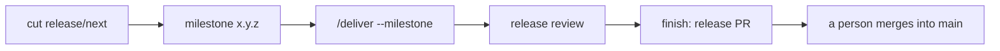

# Release a milestone

From a milestone to a release on `main`: cut `release/next`, collect the work in a milestone, deliver it, review it and let a person merge the release PR. Each step is one prompt.

::: tip Prerequisites
- `gh auth status` works, a clean `git status`, run from the repository root.
- The ruleset on `release/next` below. It is the hard gate that `/deliver` checks for.
  :::

## The path



## 1. Cut `release/next`

```text
Cut a release.
```

`github-release cut` creates the rolling `release/next` from `main`. A branch that holds unreleased work is never reset; a released one is deleted and recreated; a fresh one is left as it is. PBI pull requests target this branch. Rules for the branch types and merge methods: `references/release-branches.md` of `github-issue`.

## 2. Create and inspect the milestone

Milestones are the releases. Name them `x.y.z`.

```text
/github-milestone create 1.3.0
/github-milestone current
```

`current` is the lowest open semver milestone above the latest `v<x.y.z>` tag. It lists its open issues grouped as ready, blocked, `needs-decision`, `needs-refinement` and claimed, plus the release PR. Assign the planned PBIs and Bugs to the milestone before you deliver.

## 3. Deliver the milestone

```text
/deliver --milestone 1.3.0
```

Every open PBI and Bug of the milestone is delivered into `release/next` ([deliver guide](deliver.md#deliver-a-milestone)). For long milestones use fresh sessions per PBI ([loop](deliver.md#a-release-in-fresh-sessions)).

## 4. Release review

When nothing is left, `deliver` reviews the whole diff `origin/main...origin/release/next` against the criteria of the closed issues. Blocking findings become Bug issues in the milestone and no release PR is opened: run `/deliver --milestone 1.3.0` again. Without blocking findings, up to five notes go into the release PR. Details: [delivery reference](../delivery.md#release-review).

## 5. Finish: release PR and changelog

`deliver` runs `finish` for a fully delivered milestone. By hand:

```text
Finish the release with an updated changelog.
```

`github-release finish` opens the release PR from `release/next` into `main` (merge commit, never squash, so the `feat:` and `fix:` commits stay visible to GitVersion and git-cliff). It refuses when the branch is behind `main`, has nothing to release, was already released or has open PRs against it. `finish major` adds a deliberate major bump.

### Changelog

On first use `finish` installs git-cliff, creates `cliff.toml` from its template and adds a `changelog` script (`references/cliff-setup.md` of `github-release`). It does not edit `CHANGELOG.md`: the release job on `main` regenerates it with git-cliff, tags the version, publishes it and closes the issues of the release's PRs. Commit titles produced by `github-issue` and `github-pull-request` already follow the conventional-commit format git-cliff expects. `/github-release help` prints the usage.

## 6. A person merges into `main`

Review the release PR, then merge it with a merge commit:

```bash
gh pr merge <nr> --merge
```

`deliver` and `finish` never merge it and never wait for it. After the merge the next `github-release finish` (or `cut`) deletes `release/next`; `cut` recreates it from `main` for the next release.

## Ruleset on `release/next`

`/deliver` squash merges without asking when the review is clean and the checks are green. The ruleset is what makes that safe: a red or missing required check blocks the merge whatever the session does. At the start `deliver` runs

```bash
gh api repos/{owner}/{repo}/rules/branches/release/next --jq '.[].type'
```

and warns when `required_status_checks` is not in the output.

Settings, in the UI under **Settings > Rules > Rulesets > New ruleset > New branch ruleset**:

- Name `release/next`, enforcement **Active**.
- **Bypass list**: empty (no bypass for admins, apps or roles).
- **Target branches**: add target, include exactly `refs/heads/release/next` (a `release/**` pattern would also cover `release/<x.y>` maintenance branches).
- **Require a pull request before merging**, allowed merge methods **Squash** only (PBI branches squash into the release branch).
- **Require status checks to pass**: add your CI checks by name; leave "Require branches to be up to date" off unless you want a rebase per PBI.
- **Block force pushes** on. Leave **Restrict deletions** off: `github-release cut` (recreate) and `finish` (delete branch) run `git push origin --delete release/next`, and with an empty bypass list a deletion rule would reject them.

The same through the API (replace `build` with your check names; `integration_id` is optional):

```bash
gh api repos/{owner}/{repo}/rulesets --method POST --input - <<'JSON'
{
  "name": "release/next",
  "target": "branch",
  "enforcement": "active",
  "bypass_actors": [],
  "conditions": { "ref_name": { "include": ["refs/heads/release/next"], "exclude": [] } },
  "rules": [
    { "type": "non_fast_forward" },
    { "type": "pull_request",
      "parameters": {
        "required_approving_review_count": 0,
        "dismiss_stale_reviews_on_push": false,
        "require_code_owner_review": false,
        "require_last_push_approval": false,
        "required_review_thread_resolution": false,
        "allowed_merge_methods": ["squash"] } },
    { "type": "required_status_checks",
      "parameters": {
        "strict_required_status_checks_policy": false,
        "required_status_checks": [ { "context": "build" } ] } }
  ]
}
JSON
```

The `main` branch has its own ruleset that allows merge commits only, for the release PR. Check the result with the `gh api .../rules/branches/release/next` call above.

## Next

[Deliver issues](deliver.md), [delivery reference](../delivery.md).

## 7. Close the milestone

Once the release job has tagged `v1.3.0`, close the milestone and create the next one:

```text
/github-milestone close 1.3.0 --move-to 1.4.0
/github-milestone create 1.4.0
```

`close` needs the tag. Open issues stay and nothing is closed unless you pass `--move-to <x.y.z>`, an existing open milestone that receives them (create it first). Pull requests are not moved. A milestone that is already closed is left as is. `close` never renames, edits the due date or deletes a milestone.
