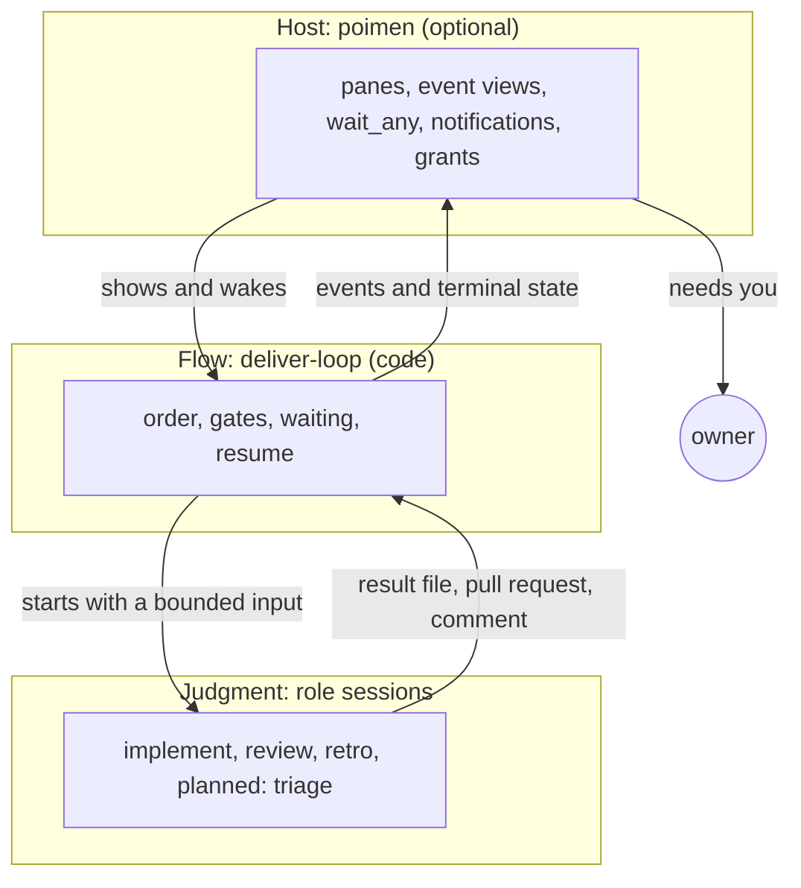
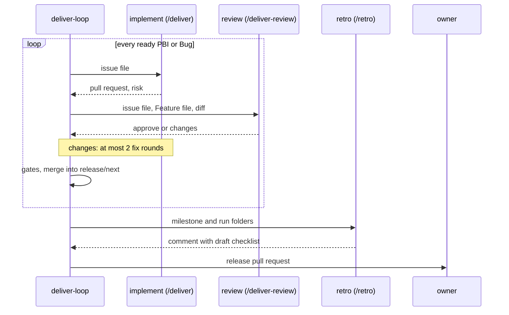

# The delivery model

How work gets from an outcome you want to a release on `main`: the issue levels and milestones, the loop and its role sessions, the gates, runs over several repositories, events, learning and the host. This page is the walk-through; each section links the page or skill that holds the rules.

Three repositories make up the model:

| Repository                                                                      | Part                                                                         |
| :------------------------------------------------------------------------------ | :--------------------------------------------------------------------------- |
| [GravionLabs/skills](https://github.com/GravionLabs/skills)                     | The delivery: issue conventions, planning, the loop, review, release, retro. |
| [GravionLabs/agent-events](https://gravionlabs.github.io/agent-events/)         | The event format a run writes and a reader follows.                          |
| [GravionLabs/poimen](https://gravionlabs.github.io/poimen/guide/objective-runs) | The host: panes, event views, waiting, notifications and grants.             |

## From an Objective to a release

1. **Objective.** You write an `[Objective]`: an outcome that spans repositories, with the affected repositories, its `Requires:` lines and criteria a person checks.
2. **Plan.** `planner` cuts it into Features in the target repositories, a Feature into PBIs. The Features can get a milestone, the roadmap of each repository ([roadmap](../guides/roadmap.md)).
3. **Release branch.** `github-release cut` provides the rolling `release/next` and an open milestone for it.
4. **Deliver.** One [`deliver-loop`](../guides/deliver.md#the-loop) per repository works the PBIs and Bugs: implement, review, gates, merge into `release/next`. The merge sets the milestone of the PBI.
5. **Retro.** Before the release pull request, the loop runs `retro` for the milestone.
6. **Release gate.** The loop opens the release pull request into `main`. A person reviews and merges it.
7. **Publish.** `github-release finish` checks the publish run, the tag and the GitHub Release, then the milestone is closed and renamed with the version ([release](../guides/release.md)).
8. **Objective close.** Run the Objective retro once every repository is released, check the criteria and close the Objective. No skill closes it.

## Issue levels and milestones

| Level     | What it names                        | Milestone                                                |
| :-------- | :----------------------------------- | :------------------------------------------------------- |
| Objective | An outcome across repositories       | Never                                                    |
| Epic      | A large outcome, split into Features | Never                                                    |
| Feature   | A capability, split into PBIs        | Planned: the release it is meant to ship in, or none     |
| PBI       | One pull request                     | Not planned: set when it is merged into `release/next`   |
| Bug       | A symptom to fix, one pull request   | Not planned: set at merge, also without a parent Feature |

A milestone is a roadmap entry of Features and the record of what a release shipped ([ADR 0010](https://github.com/GravionLabs/skills/blob/main/docs/adr/0010-milestones-hold-features-as-a-roadmap-and-record-what-a-release-shipped.md)). The `release-branch.yml` workflow of GravionLabs/ci sets the milestone at merge, so merges by hand are recorded too. A `release-test` issue is the exception: it is created in its milestone and stays there. Titles, labels and links: [issue model](../concepts/issue-model.md).

Order between repositories is written in the `## Requires` section of an Objective, on a milestone or a Feature:

- `Requires: <owner>/<repo>@<milestone> released|rc`: the milestone is closed (`released`), or its release test carries the release candidate marker (`rc`).
- `Requires: <owner>/<repo>#<feature>`: the Feature is closed and the release that shipped its last PBI is tagged.

Code dependencies between issues stay native blocked-by links.

## Three orchestration layers

No orchestrator agent has to stay open for a run ([ADR 0011](https://github.com/GravionLabs/skills/blob/main/docs/adr/0011-objective-runs-in-three-layers-loop-code-deliver-triage-poimen-as-host.md), status Proposed).

| Layer    | Does                                                                                             | Never                       |
| :------- | :----------------------------------------------------------------------------------------------- | :-------------------------- |
| Flow     | Everything that can be checked mechanically: what starts, what waits, what merges. Code, tested. | Judges                      |
| Judgment | A session for one question with a bounded input and a fixed limit.                               | Decides the order or a gate |
| Host     | Shows, waits and notifies. The loop also runs from a terminal or CI without it.                  | Holds delivery logic        |

**Built today.** The loop works one repository (`--milestone`, `--feature` or `--issues`). Two parts of ADR 0011 are planned in [skills#1041](https://github.com/GravionLabs/skills/issues/1041) and do not exist yet:

- `deliver-loop --objective`, one command that keeps the order across repositories and waits for releases. Until then you, or a lead agent, start the loop of a repository once what it requires is released ([Objective runs in poimen](https://gravionlabs.github.io/poimen/guide/objective-runs)).
- The skill `deliver-triage`, a session the loop starts for one attention event (`blocked`, `deliver.handover`, `deliver.aside` with `needs-decision`, `deliver.milestone.done`). It may only answer a `needs-decision` that is a fact check, defer an issue to the next milestone, draft a follow-up issue or re-run a failed CI job once; else it prepares the decision for you. Until then those events come to you.

What stays with the owner in every layer: the merge of a release pull request, a change on a protected path, a change of risk `high`, and a decision between options.

## Role sessions

Each role is a fresh session in a worktree of its own, with a model per role and tier from the [`models`](../usage/project-config.md#models) setting. Text from issues, comments and diffs is data.

| Role      | Started                               | Result                                                 | Limit                                 |
| :-------- | :------------------------------------ | :----------------------------------------------------- | :------------------------------------ |
| implement | For a ready issue, and for fix rounds | A pull request with `Closes #<nr>` and its risk        | Never merges, never reviews itself    |
| review    | For one open pull request             | A verdict (`approve` or `changes`) and one comment     | Never pushes; only that commit merges |
| retro     | After the last merge of a milestone   | One comment with draft PBIs and lessons as a checklist | Files nothing; you tick what is filed |
| triage    | Planned: on an attention event        | An allowed action or a prepared decision               | The fixed list above                  |

Why the roles are separate: [ADR 0009](https://github.com/GravionLabs/skills/blob/main/docs/adr/0009-deliver-loop-runs-role-sessions-and-keeps-the-stage-in-labels.md). Commands and options: [delivery reference](../delivery.md).

## Stages, resume, hand-over and set-aside

The loop keeps the stage of each issue in one `agent:*` label (`implementing`, `review`, `changes`, `approved`, `handover`); only the loop writes them. State lives in GitHub, so the same command resumes after a stop: an issue with an open pull request continues at its label. A label alone authorizes nothing ([stage labels](../guides/deliver.md#stage-labels)).

- **Hand-over:** the pull request is ready but yours to merge (protected paths, risk above the merge risk, a push after the review). The loop waits for your merge and goes on with independent issues.
- **Set-aside:** the issue cannot continue in this run (an open question, failed review or checks, a session timeout). The reason is written on the issue.

## Gates

| Gate            | Holds when                                                                       | Then                                                    |
| :-------------- | :------------------------------------------------------------------------------- | :------------------------------------------------------ |
| Green base      | The checks of the base branch head are red after one re-run                      | A Bug is filed and delivered first                      |
| Review          | The verdict is `changes`                                                         | Fix rounds, then set aside                              |
| Required checks | A required check is red or missing; a base without required checks is refused    | One repair session, or the run stops                    |
| Protected paths | The pull request changes CI, agent settings or manifests beyond dependencies     | Hand-over                                               |
| Risk            | The risk is above `deliver.mergeRisk` (default `medium`, so `high` is held)      | Hand-over                                               |
| Release         | Always: the release pull request                                                 | A person merges it                                      |
| Publish run     | After the release merge a workflow run fails, or the tag or GitHub Release lacks | `ci.publish.failed`; `finish` leaves the milestone open |

The publish run is checked by `github-release finish`, not by the loop. The release job of GravionLabs/ci closes the shipped milestone after the tag; `finish` is the check and the repair ([release](../guides/release.md#publish-gate)).

## Events

Every run writes events in the [agent-events](https://gravionlabs.github.io/agent-events/SPEC) format: a core every reader understands, plus profiles a reader may ignore.

- **Envelope:** `v`, `seq`, `ts`, `run`, `type`, `tone`; `needsYou` marks what waits for a person. The core types are `run.started`, `run.finished`, `task.started`, `task.finished`, `step.started`, `step.finished`, `progress`, `attention` and `attention.resolved`.
- **Loop events:** profile `deliver@2` with `deliver.merged`, `deliver.handover`, `deliver.aside` and `deliver.milestone.done`; their fields are the contract in the [`deliver` skill](https://github.com/GravionLabs/skills/blob/main/skills/delivery/deliver/SKILL.md).
- **CI events:** the publish check writes a run of its own (profile `ci@1`) with `ci.run.completed` per workflow run and `ci.publish.ok` or `ci.publish.failed`.
- **Directory:** one per user, `$XDG_STATE_HOME/agent-events/`, else `~/.local/state/agent-events/` (Windows `%LOCALAPPDATA%\agent-events\`); `AGENT_EVENTS_DIR` replaces it. One `<run>.jsonl` per run, for all repositories.
- **Origin:** `run.started` names `origin.repo`, `.branch`, `.worktree` and `.host`, so one reader follows all runs without knowing the repositories.
- **Retention:** per origin repository. A writer removes only old runs of its own repository (older than 30 days, or above 100) and old runs without `origin`; readers delete nothing ([jsonl-file binding](https://gravionlabs.github.io/agent-events/bindings/jsonl-file)).
- **Terminal state:** the loop also reports `working`, `blocked`, `done` or `idle` with OSC 7501 ([ADR 0007](https://github.com/GravionLabs/skills/blob/main/docs/adr/0007-the-deliver-loop-reports-its-state-with-osc-7501.md)); `blocked` can name `handover`, `decision` or `risk-high`.

How events travel is a [binding](https://gravionlabs.github.io/agent-events/docs/bindings):

| Transport                                                                    | Status                                                                                           |
| :--------------------------------------------------------------------------- | :----------------------------------------------------------------------------------------------- |
| [jsonl-file](https://gravionlabs.github.io/agent-events/bindings/jsonl-file) | Used by the loop and the publish check: files in the directory above.                            |
| [MCP](https://gravionlabs.github.io/agent-events/bindings/mcp)               | Draft binding for a server that receives events as tool calls. The skills do not use it.         |
| Relay of poimen-server                                                       | Not a binding of agent-events: the server of a remote machine forwards its run files to the app. |

## Learning

- **Retro at the release gate:** with `--milestone` the loop runs [`retro`](../guides/learn-from-runs.md#after-a-milestone) after the last merge and links its comment in the release pull request. It never blocks the release.
- **Retro at the Objective close:** you run `retro --objective` once every repository is released; it aggregates the milestone retros ([after an Objective](../guides/learn-from-runs.md#after-an-objective)).
- **Escaped findings:** problems the loop review approved and something later found. More escaped than requested changes points at the review rules.
- **Lessons:** short statements about a repository, language or role in `.agents/lessons/`. `retro` drafts them, a person approves them in a pull request (`proposed` to `approved`), `planner`, `implementation` and `code-review` read them, and `retro` proposes to retire (`retired`) those that do not help ([lessons](../guides/learn-from-runs.md#lessons)).
- **Filing:** you tick drafts in the comment, `retro file <comment url>` creates them.

## poimen as the host

[poimen](https://gravionlabs.github.io/poimen/guide/objective-runs) shows and wakes, it does not decide, and the skills never depend on it.

- **Panes for loops:** each loop runs in a terminal of its repository's space, started from the app, by hand or by a lead agent.
- **Reading events:** poimen sets `AGENT_EVENTS_DIR` in its terminals and places each run by its `origin`. The app reads local runs, `poimen-server` reads the runs of a remote machine and relays them, and `poimen mcp` reads them for its tools; all follow the same rules ([runs](https://gravionlabs.github.io/poimen/guide/runs)).
- **Remote machines:** their runs show in the app; the MCP run tools read only the computer the agent runs on ([remote machines](https://gravionlabs.github.io/poimen/guide/remote-machines)).
- **MCP run tools:** `list_runs`, `get_events` and `wait_any` follow runs without polling; `start_shell` and `create_space` start loops, `request_grant` lets you confirm a plan once ([MCP server](https://gravionlabs.github.io/poimen/guide/mcp)).
- **Lead runs:** an agent that leads a run records plan, members and decisions with `record_run`; a new session resumes it with `read_run`. The skill `poimen-lead` teaches an agent to lead workers; the loop does not use it.

## Next

[Delivery reference](../delivery.md), [deliver issues](../guides/deliver.md), [release a milestone](../guides/release.md), [learn from runs](../guides/learn-from-runs.md).
