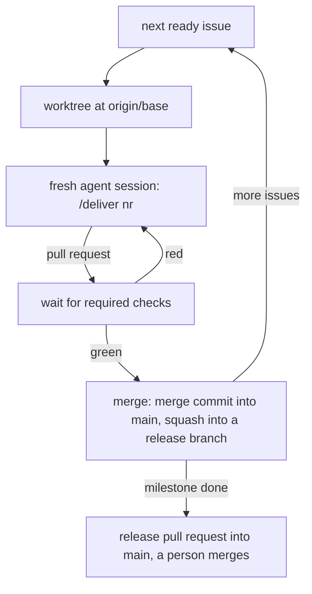

# Deliver issues with /deliver

`/deliver <nr>` takes one open PBI or Bug and delivers it as a pull request into the base branch (`release/next` for a milestone, else the default branch). The `deliver-loop` runs it for a whole milestone or a list of issues: a fresh agent session per issue, each in its own worktree, and it merges the pull request once every required check passed. The reference is in [delivery](../delivery.md); coming from the PowerShell loop: [migrating](migrate-powershell-loop.md).

::: tip Prerequisites
- `gh auth status` works and you can push to the repository.
- Node 24 or newer: the loop is TypeScript that Node runs directly (type stripping, no build); an older Node fails on the `.mts` file.
- A GitHub ruleset on the base branch with required checks. The loop refuses a base without them.
- The agent CLI of the harness (`claude`, or `copilot`) is installed and signed in.
- `git`, `gh` and the verify commands of your `AGENTS.md` are allowed for the agent, otherwise an unattended session stops at a prompt.
  :::

## One issue

```text
/deliver 42
/deliver 42 --base main
```

The session reads the issue, branches `<type>/<nr>-<slug>` from `origin/<base>`, implements with tests, runs the verify commands of `AGENTS.md`, has a subagent review the diff against the acceptance criteria (at most 2 fix rounds), opens the pull request with `Closes #42` and ends. It never merges. Its last line is `result: pr <url>`, `result: needs-decision` or `result: blocked <reason>`. An unclear criterion is never guessed: the session comments on the issue, adds `needs-decision` and ends without a pull request.

An existing branch is continued, and an open pull request is repaired (red check, conflict with the base) instead of recreated.

## The loop



```powershell
deliver-loop --milestone M004
deliver-loop --issues 12,15 --max 3
deliver-loop --milestone M004 --dry-run
```

Install the `deliver-loop` command with `skills-manage` ([launcher](#the-deliver-loop-command)). Without it: `node <skill-dir>/scripts/deliver-loop.mts --milestone M004`.

The loop reads the state from the tracker before every issue and remembers only what it set aside, so it can be stopped and started again. It orders the issues by their blocked-by links, skips those with `needs-decision`, `needs-refinement` or an open blocker, and merges one pull request before the next issue starts. `--dry-run` prints the order, the required checks and the session token source and starts nothing.

Name the milestone `M<nnn>` (`M004`): the lookup finds the open `M004` and, after `/github-milestone close M004` renamed it, `M004 (0.2.0)`. A legacy title such as `1.3.0` works as before; to move a repository to `M<nnn>` see [Migrate legacy milestones](release.md#migrate-legacy-milestones).

With `--milestone`, once no PBI or Bug of the milestone is open (none set aside or waiting), the loop opens the release pull request from the base into the default branch and prints its URL. It never merges it. An open `release-test` issue is never started: it is listed as needs you. A missing `release/next` (the release merge deletes it) is cut from the default branch.

## Options

| Option                       | Meaning                                                                                               |
| :--------------------------- | :---------------------------------------------------------------------------------------------------- |
| `--milestone <M>`            | The open work items of a milestone. Exactly one of `--milestone` and `--issues`.                      |
| `--issues <nr,…>`            | These issues.                                                                                         |
| `--base <branch>`            | Base branch. Default `deliver.base`, else `release/next` with `--milestone`, else the default branch. |
| `--harness <name>`           | `claude` (default) or `copilot`. `--model <name>` passes a model of that harness.                     |
| `--max <n>`                  | Stops after `n` issues.                                                                               |
| `--session-minutes <n>`      | Longest session. Default 90.                                                                          |
| `--merge-minutes <n>`        | How long it waits for checks after a pull request. Default 30.                                        |
| `--dry-run`                  | Print the plan, start nothing.                                                                        |
| `--allow-no-required-checks` | Deliver into a base without required checks.                                                          |
| `--trust-authors`            | Also deliver issues of authors without write access.                                                  |

Exit codes: 0 everything done or `--max` reached, 2 open issues remain and none is ready, 3 the base is missing or has no required checks, 64 wrong arguments or settings, 130 stopped with Ctrl+C. Colored progress goes to the terminal (`NO_COLOR` turns it off) and to `<git-common-dir>/deliver/loop.log`; to stop from another terminal create the file `stop` in the run folder `<git-common-dir>/deliver/<run>/`.

## Settings

Optional, under `deliver` in `.agents/config.json` ([project config](../usage/project-config.md#deliver)); the flag of the same name wins.

| Key              | Default                                                      |
| :--------------- | :----------------------------------------------------------- |
| `base`           | `release/next` with `--milestone`, else the default branch   |
| `tracker`        | `github` (`scripts/tracker/<name>.mts`)                      |
| `harness`        | `claude`; a name only, a repository cannot set a command     |
| `protectedPaths` | `.github/`, `.agents/`, `.claude/` and the package manifests |

Other keys (`roles`, `loopThreshold`, `parallel`, `sessionTimeoutMinutes`) are ignored with one warning line. `DELIVER_MIN_<X>` variables are read as `DELIVER_<X>` for one more release, with a warning.

## What the loop refuses

- **A base without required checks.** Nothing would guard the merge. Add a ruleset with required checks, or pass `--allow-no-required-checks`. Exit 3.
- **Issues of authors without write access.** Anyone can open an issue, and its text becomes the task of an agent. Such an issue is listed as waiting (`author has no write access`); `--trust-authors` delivers it.
- **Pull requests that change protected paths.** The loop does not merge a pull request that touches `.github/`, `.agents/`, `.claude/` or a package manifest (a workflow or an agent setting would let a change run with more rights). It says why and leaves the merge to you. `deliver.protectedPaths` replaces the list.
- **A merge before the checks have reported.** The loop merges only when every required check has reported and passed, with your own login.

## The session token

The agent session runs with a token of its own instead of your login, so it can push its branch and open the pull request but nothing more.

- **GitHub App (preferred).** Set `DELIVER_APP_ID` and the private key as a file (`DELIVER_APP_KEY_FILE`) or as a command that prints it (`DELIVER_APP_KEY_COMMAND`, for example `op read …`). The loop mints an installation token for the repository of the run (contents, pull requests and issues write; no workflows, no administration) and renews it before a session starts when less than `--session-minutes` of it is left. A token lives one hour, so keep `--session-minutes` below 60 with an app. A failed mint sets the issue aside; the loop never falls back to your login.
- **`DELIVER_SESSION_TOKEN`.** A fine-grained token limited to the repository.
- **Neither.** The loop says that the session uses your login.

The key is never logged, written to events or the run folder, or passed to the session.

## The deliver-loop command

`skills-manage` writes a launcher file instead of a shell function:

```powershell
pwsh <skill-dir>/scripts/Install-LoopShim.ps1 -DryRun
pwsh <skill-dir>/scripts/Install-LoopShim.ps1
```

- macOS and Linux: `~/.local/bin/deliver-loop` (executable).
- Windows: `%USERPROFILE%\.local\bin\deliver-loop.cmd` and `deliver-loop.ps1`. PowerShell runs the `.ps1`, so Ctrl+C does not ask "Terminate batch job".

The launcher finds the installed `deliver` skill (project first, then your home) and runs `node <skill-dir>/scripts/deliver-loop.mts` with the arguments it gets, from the repository root. The installer removes the old `# >>> deliver-loop >>>` block from `~/.zshrc`, `~/.bashrc` and the PowerShell profiles, because a function of the same name hides the file. It reports when `.local/bin` is not in `PATH` and says how to add it; it never changes `PATH`. A second run changes nothing.

## Resume and feedback

State lives in GitHub (issue, branch, pull request, checks). After a crash, a closed terminal or a stop, run the same command again: closed issues are not selected, an existing pull request goes straight to its checks. A session that ends `needs-decision` or `blocked` is set aside for the rest of the run and listed at the end with its reason. Answer in the issue, remove the label (`gh issue edit 43 --remove-label needs-decision`) and run again.

## Progress events

The loop writes [agent-events](https://github.com/GravionLabs/agent-events) to `<git-common-dir>/.agents/events/<run>.jsonl`: the run, one task per issue with its pull request, progress, and an attention for an issue set aside. The session reports nothing itself. Displays such as [herdr](herdr.md) read the file.

## Troubleshooting

Set-aside issue, missing ruleset or red check: [troubleshooting](../reference/troubleshooting.md).
