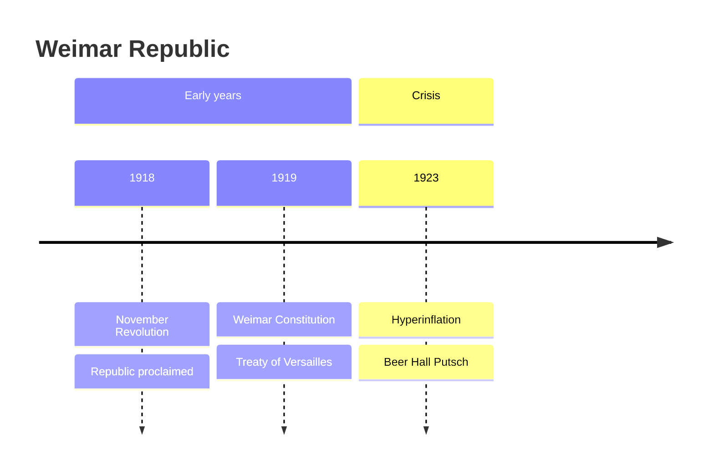

# school-timeline

Topic: `$ARGUMENTS`

Resolve the vault first and read the profile: `pwsh ../vault-inbox/scripts/Get-VaultRoles.ps1 -Vault <vault root>` prints `language`, the roles and `files.profile`. Roles, profile fields, file name patterns and the rules every note follows: `../school-summary/references/school-vault.md` (read it).

## Steps

1. Find the topic folder, read the profile, the transcriptions and an existing summary.
2. Collect all dated events and reduce them to those that matter for understanding (8-15).
3. Write the timeline note (name pattern of the vault's language) and link it from the summary; do not edit the summary beyond that link. A timeline exists: extend it.

## Structure

Headings in the note language; English form (the Mermaid block is the diagram, the table follows):

````markdown
# <Topic> - Timeline



## Events

| Date       | Event               | Significance          |
| ---------- | ------------------- | --------------------- |
| 1918-11-09 | Republic proclaimed | End of the monarchy … |

## Lines of development

2-4 sentences: which phases are there, what drives the change?
````

## Rules

- Mermaid entries are short keywords, no colon or brackets inside an entry (a colon separates entries).
- Group in `section`s when there are more than about six events.
- Exact dates in the table, the diagram shows the year only.
- Dates only from the sources or certain knowledge; added events get `(addition)` in the table. Source and knowledge disagree: name both.
